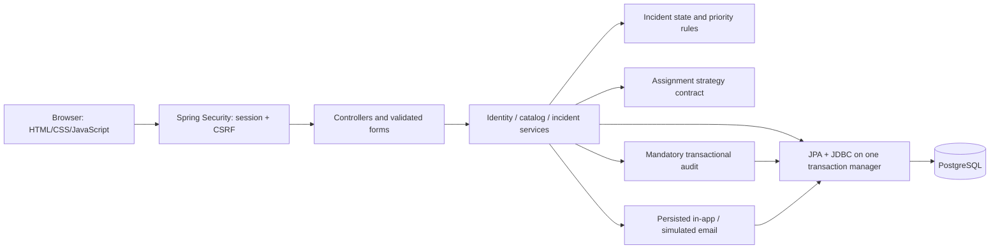
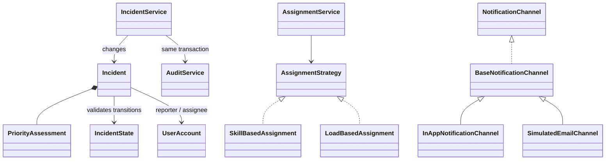

# Architecture and implementation contracts

Reviewed against the implemented Phase 1–4 scope on 16 November 2026. Final submission UML/ER/report artifacts remain Phase 8 deliverables.

## Runtime and boundaries

One Spring Boot modular monolith renders Thymeleaf pages and offers read-only JSON endpoints. PostgreSQL stores accounts, catalog, incidents, conversations, resolutions, SLA cycles/events, notifications and audits. Flyway owns schema changes; Hibernate validates it. There is no separate frontend build, required Docker service, JWT infrastructure or broker.

Pinned/verified setup: Java target 21, actual tested JDK 25.0.1; Spring Boot 3.5.16; Maven Wrapper 3.3.4 and Maven 3.9.11; PostgreSQL test tooling Zonky 2.1.0 with native Apple Silicon PostgreSQL 14.15.0; Surefire/Failsafe 3.5.6. JDK 21 execution and other OS/browser combinations have not been independently run here.

## Domain contracts and patterns

- **State:** `IncidentState` owns explicit allowed edges; enum declaration order cannot silently change them. `Incident` guards lifecycle mutations. Service-level role, assignment and version checks precede commands.
- **Strategy:** `AssignmentStrategy` has skill-based and load-based implementations. Eligibility and capacity are checked before selecting a candidate. Existing strategy tests demonstrate different outcomes; full Phase 5 acceptance is still separate.
- **Inheritance/polymorphism:** `BaseNotificationChannel` implements shared persistence behavior; in-app and simulated-email subclasses supply channel/status behavior through the notification contract. No actual external email is sent.
- **Composition:** incidents embed a `PriorityAssessment`; the incident service composes catalog, assignment, audit, SLA and notification services. Framework repositories support these contracts rather than replacing business rules.

Priority is impact × urgency × snapshotted service criticality. P4=1–2, P3=3–7, P2=8–17, P1=18–27. Affected-user count is context. Reporter inputs cannot directly set priority, reporter identity, assignment or status. Reasoned administrator corrections audit old/new factors. Repeat-report correlation/escalation is approved follow-up scope, not implemented.

## Interfaces and access

| Interface | Contract |
|---|---|
| `/register`, `/login`, POST `/logout` | Employee registration; role cannot be injected; hashed passwords; sessions; CSRF-protected mutations |
| `/employee/incidents/new`, POST `/employee/incidents` | Validated title/description/catalog/impact/urgency/affected count; retain invalid input |
| `/incidents`, `/incidents/{id}` | Lists/details scoped to reporter, assigned technician or active administrator |
| POST `/incidents/{id}/action` | Versioned acknowledgment/start/resolve/verify/close/reject; invalid edges and roles rejected |
| POST `/incidents/{id}/messages` | Versioned public/internal/request messages; only reporter replies to same-incident requests |
| POST `/incidents/{id}/feedback` | Optional reporter feedback after resolution; rating 1–5; once per incident |
| `/admin/users`, `/admin/catalog`, `/admin/audit`, `/admin/email` | Active administrator only; sensitive configuration writes check actor at service boundary too |
| `/api/incidents`, `/api/incidents/{id}`, `/api/metrics` | Authenticated read-only projections; ownership/role scope; no entity/password serialization |

Incident history services recheck current actor access. Staff-only suggestions and private investigation events are omitted from employee history. Account deactivation/role changes invalidate session access on the next request. Forbidden POST forwards now return 403 through the error page. Input/output escaping is verified; this is not a penetration-test or production-hardening claim.

## Transactions, history and concurrency

Incident mutations combine JPA entity changes with JDBC child records under one Spring transaction. `AuditService` requires an existing transaction; an audit cannot silently commit separately. PostgreSQL constraints enforce foreign keys, bounds and uniqueness. A database lock serializes assignment/configuration-sensitive changes, and incident versions reject stale edits. V4 conversation revision ensures even identical-clock message writes advance the incident version.

Audit records carry incident reference, actor/System identity, timestamp, action, prior/new lifecycle state and context. Priority before/after values are descriptions rather than lifecycle states. Histories order by persisted IDs because several events may share a transaction timestamp. Earlier published audit records are not rewritten. There is no claim of tamper resistance against a direct database writer.

Rejection retains old resolution/cycle/breach records and first response/resolution timestamps; a new cycle starts with stored targets. Failed commands roll back state, child rows, audits and simulated notification rows together. Future real external notification delivery needs separate failure handling in Phase 5; no external calls occur in these transactions today.

## Remaining phase gates

Phase 5: complete assignment/SLA/notification acceptance, concurrency/capacity and restart catch-up scenarios. Phase 6: AI adapter/failure cases and reporting acceptance; live AI model/key/budget remain pending. Phase 7: broader stabilization/security/performance cases. Phase 8: final diagrams/report/member responsibility/video/submission evidence.
