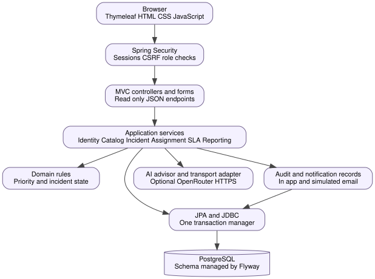
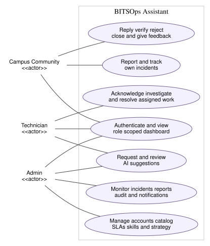
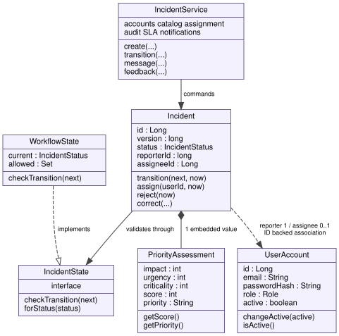
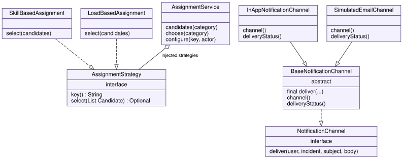
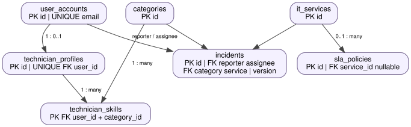
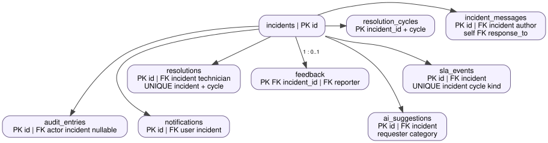

# BITSOps Assistant

Intelligent IT Service Managementand Incident Resolution System

CS F213 / MAC F212 Object Oriented ProgrammingBITS Pilani Hyderabad CampusSemester I 2026-2027

Group project reportDraft for team review | 20 November 2026

| Submission detail | To be completed by the team |

| --- | --- |

| Group number | Pending |

| Member 1 name and student ID | Pending |

| Member 2 name and student ID | Pending |

| Member 3 name and student ID | Pending |

| Individual contributions | Pending confirmation by each member |

## Report scope

This report describes the implemented campus IT support website, its object-oriented design, database, operating rules and recorded verification. It is grounded in source revision cec3bcfed486c9ffbd5b4ee4c2c70f96269bcb50. Later changes on another device are outside this snapshot until supplied.

Core incident handling, assignment, SLA monitoring and reporting are implemented. AI suggestions are verified with controlled providers; live OpenRouter verification is pending. Approved incident correlation is not implemented. Recent password recovery discussions are proposals only. This is a review draft, not a declaration of completed submission.

# Report guide and abstract

| Pages | Content |

| --- | --- |

| 1-3 | Cover, abstract, problem analysis and stakeholders |

| 4-5 | Requirements and system architecture |

| 6-8 | UML use cases and class design |

| 9-10 | ER diagram, schema and sample data |

| 11-12 | Business rules and technology justification |

| 13-14 | Documented test cases and execution scope |

| 15-17 | Security, operation, evaluation, demo and references |

## Abstract

BITSOps Assistant is a browser-based IT service management system for a campus. Campus Community members report incidents, technicians investigate assigned work, and administrators configure support policies and monitor operations. A single Spring Boot application renders Thymeleaf pages using HTML, CSS and JavaScript, while PostgreSQL preserves operational records.

The system calculates priority from impact, urgency and service criticality; selects eligible technicians through interchangeable skill-based and load-based strategies; and tracks response and resolution SLAs. Explicit state rules prevent invalid lifecycle changes. Transactional audit and notification records preserve the explanation of each significant action. Optional OpenRouter integration proposes categories and resolution drafts for staff review.

The main design result is an extensible modular monolith with business rules separated from controllers and persistence. Historical Linux acceptance records show 198 regression cases and two packaged restart cases passing for the earlier backend snapshot. Later UI checks are recorded separately; final visual acceptance of the lavender interface and live provider testing remain open. No throughput or production readiness claim is made.

## Reading the evidence

Implemented means the relevant code exists in the stated revision. Verified means a specific recorded test run supports that behavior. Proposed means a feature has not been built. Test results in this report are historical evidence from project records, not a new execution performed while writing this document.

# Problem analysis and stakeholders

## Problem and existing challenges

Campus IT failures affect Wi-Fi, authentication, email, laboratory computers and printers. Reports made through informal channels can omit important context, reach the wrong technician, or disappear without a traceable outcome. Support teams need consistent priority decisions, visible workload and deadlines, and an explanation of how a complaint was resolved.

The project addresses coordination and accountability. It does not monitor network equipment directly or independently establish the physical cause of an outage. Users supply incident information and technicians remain responsible for investigation and resolution.

| Stakeholder | Need and responsibility |

| --- | --- |

| Campus Community | Report and track their own incidents, answer requests, review fixes and give feedback. Includes students and other campus members. |

| Technician | View assigned work, acknowledge, investigate, request information and record a resolution. |

| Admin | Manage accounts, catalog, technician capacity and skills, policies, assignment strategy, incident oversight and audits. |

| Course evaluators | Inspect requirements, working workflows, OOP design, test evidence and identifiable team contributions. |

## Proposed solution and assumptions

Use a local-first website with three authenticated roles and a central relational store. Campus Community is the visible label of the stored EMPLOYEE role; it is not a fourth role. Public registration cannot grant staff privileges. Staff accounts are created by an administrator.

SLA time runs continuously, including nights and weekends. Conversations do not pause it. Service criticality and SLA targets are copied onto each incident so future catalog edits do not silently rewrite old promises. Deactivation preserves historical relationships. Public hosting, live email and paid provider usage are not prerequisites for the local demonstration.

# Requirements and scope

| Area | Functional requirement |

| --- | --- |

| Identity and access | Register Campus Community accounts; log in/out; enforce current role, ownership and activity. |

| Incident lifecycle | Report, classify, prioritize, assign, acknowledge, investigate, resolve, verify and close; retain rejection cycles and feedback. |

| Configuration | Manage services, categories, technician skills/capacity, SLA defaults and overrides, and assignment strategy. |

| Automation | Calculate priority, select technicians, detect warning/breach thresholds and persist deduplicated alerts. |

| Communication | Public messages, private staff notes, linked information requests and replies; in-app and simulated-email records. |

| Intelligence | Optional category suggestions and resolution drafts; staff must explicitly apply valid advice. |

| Reporting | Combine text/ID, status, priority, category, service, technician, date range and SLA status filters. |

| Persistence and audit | Persist accounts, catalog, incident history, resolutions, SLA cycles/events, suggestions and notifications. |

## Nonfunctional requirements

Maintainability comes from module boundaries and interfaces. Integrity comes from database constraints, transactions and version checks. Security requires session authentication, role checks, protected passwords, CSRF controls and escaped output. Reproducibility relies on pinned build tooling, migrations and documented launch commands. Responsive layouts support desktop and narrow screens; the current redesign still needs a final visual run.

## Requirements reconciliation

R01-R13 and R15-R19 map to implemented roles, workflows, automation, search, OOP, errors, security and persistence. R14 has implemented rule automation plus controlled-provider AI evidence; live AI is not verified. R20-R25 are addressed by this report, diagrams, repository and test records, subject to final review. R26-R27 require a recorded demonstration and confirmed contributions. Correlation remains an approved project gap, even though the course permits other automated features. Duplicate incident detection must not be claimed.

# System architecture

Figure 1. Runtime architecture. External AI is optional; email notifications in this revision are stored simulations. All ordinary business mutations stay inside the application and database boundary.

## Request and transaction boundaries

Controllers validate form shape and obtain the authenticated actor. Services recheck current authorization, assignment and incident version before invoking domain behavior. JPA updates the incident while JDBC persists related records under the same transaction manager. Required audit or notification failures roll back the business action rather than leaving a partially recorded outcome.

AI network calls occur outside the save transaction. The service rechecks the incident version when saving a response and when applying it. This prevents a slow provider response from overwriting newer work. SLA scans run on startup and periodically, and persist unique event keys for restart-safe deduplication.

# UML use case diagram

Figure 2. Actors and principal use cases. Lines indicate participation, not unrestricted access to all incident records.

## Authorization within each use case

Campus Community sees their own incidents. Technicians see assigned incidents. Active administrators have broader oversight. Staff investigation notes and generated suggestion events are hidden from the reporter. Reporter verification and rejection are distinct from administrator overrides; an override requires a recorded reason.

SLA monitoring is an internal scheduled activity, not another human role. The external AI provider returns suggestions and has no authority to transition incidents. Simulated email has no external recipient interaction.

# UML domain class design

Figure 3. Selected implemented domain classes. Fields and operations are abbreviated. Incident-to-account relationships use identifiers and database foreign keys rather than invented JPA object references.

## Encapsulation and composition

Incident mutations pass through methods that enforce transitions and timestamps; callers cannot treat enum ordinal order as a workflow. PriorityAssessment is embedded in Incident and represents its owned priority value. UserAccount stores a password hash and activity state. The service composes collaborators rather than inheriting from controllers or persistence services.

IncidentState uses an EnumMap from status to WorkflowState objects. Each object stores a Set of permitted destinations and checks transitions. This is a lightweight state implementation, not a hierarchy with a separate class for every status.

# UML extension contracts and OOP

Figure 4. Assignment Strategy and notification inheritance. Hollow diamond denotes shared, injected collaborators; the service does not own their object lifetime.

| Concept or pattern | Concrete evidence and purpose |

| --- | --- |

| Strategy | AssignmentStrategy plus SkillBasedAssignment and LoadBasedAssignment vary ranking without rewriting the workflow. |

| State | IncidentState and WorkflowState validate explicit edges, with Incident enforcing calls. |

| Adapter and repository | OpenRouterAdapter implements AiTransport; IncidentRepository extends JpaRepository. External and storage details stay behind contracts. |

| Inheritance and polymorphism | Both notification subclasses are notification channels; common final delivery code varies channel/status through overridden operations. |

| Collections and exceptions | List candidates, Optional selection, EnumMap states and Set edges match their tasks. BusinessException and ConflictException represent invalid commands and stale edits. |

# Database entity relationship diagram

Figure 5a. Account, catalog and incident relationships. Technician skills form a many-to-many link between technician profiles and categories.

Figure 5b. Incident history. Other incident edges are one-to-many. Box labels identify additional user/category foreign keys. Cycle numbers in resolutions/events are logical links, not enforced composite foreign keys to resolution_cycles.

V1 creates identity, catalog, default SLA policies and audit storage. V2 adds workflow and communication tables and augments audit relationships. V3 adds demo seed markers; V4 adds conversation revision. Published migrations are preserved, and Hibernate validates the resulting schema.

# Schema integrity and sample data

| Table group | Important fields and constraints |

| --- | --- |

| Accounts and technicians | Lowercase trimmed unique email; protected hash; role constraint; active flag; version. Technician user_id is unique; capacity 1-100. |

| Catalog and policy | Criticality 1-3; active catalog records; positive targets; resolution target at least response target. Partial unique indexes distinguish default and service-specific policies. |

| Incidents | Version, score 1-27, priority P1-P4, explicit status, timestamps, stored factors and SLA targets, assignee and reporter references. |

| Messages and resolutions | Message kind and optional self-reply FK; one resolution per incident/cycle; prior cycles preserved after rejection. |

| SLA and feedback | Unique incident/cycle/kind prevents repeated alerts; feedback has incident primary key and rating bound 1-5. |

| Audit and suggestions | Audit actor may be null for System; incident is linked where relevant. Suggestions store incident version and application time. |

## Actual migration seed values

| IT service | Criticality |

| --- | --- |

| Campus Wi-Fi | 3 |

| Campus login | 3 |

| Campus email | 2 |

| Lab computers | 2 |

| Printers | 1 |

Seed categories: Network, Authentication, Hardware, Software, Email and Other. Categories can be extended administratively. Demo accounts are optional and require a locally chosen DEMO_PASSWORD; no default secret is shipped. Seed logic does not overwrite existing passwords.

## Illustrative incident record

Example only, not a record extracted from a user database: “Lab Wi-Fi unavailable”, service Campus Wi-Fi, category Network, impact 3, urgency 2 and criticality 3 yields score 18 and P1. Created at 10:00 IST, its default response deadline is 10:05 and resolution deadline 10:30. Assignment depends on actual eligible staff, not a fixed technician ID.

# Priority assignment and SLA rules

Priority score = impact x urgency x snapshotted service criticality. Each factor is 1-3. P4 covers scores 1-2, P3 3-7, P2 8-17 and P1 18-27. The thresholds emphasize combined severity and are a transparent project policy, not an empirically calibrated industry standard. Affected-user count is retained as context and does not independently multiply the score.

## Assignment and lifecycle

Eligible technicians must be active, available, skilled for the category and below capacity. Skill ranking orders proficiency descending, then active workload ascending, then user ID. Load ranking orders workload ascending, then proficiency descending, then user ID. A configuration lock serializes capacity-sensitive changes. With no eligible technician, the incident remains classified and administrators are notified; the SLA continues.

The normal path is NEW, CLASSIFIED, ASSIGNED, ACKNOWLEDGED, IN_PROGRESS, RESOLVED, VERIFIED, CLOSED. Staff reassignment and reporter rejection can return an incident to CLASSIFIED through guarded commands. Reassignment needs a reason and fresh acknowledgment. Rejection preserves old fixes and starts another resolution cycle; closed incidents cannot reopen. Feedback is optional and submitted only once by the reporter.

| Priority | Response target | Resolution target |

| --- | --- | --- |

| P1 | 5 minutes | 30 minutes |

| P2 | 15 minutes | 2 hours |

| P3 | 1 hour | 8 hours |

| P4 | 4 hours | 24 hours |

Service-specific policies override defaults. Targets are snapshotted at creation. Warnings occur at 80% elapsed and breaches strictly after the deadline; completion exactly at the deadline is on time. Startup and periodic scans persist deduplicated events. A first overdue scan emits a breach rather than a retrospective warning. Response is first acknowledgment; rejection starts a new resolution deadline using stored targets. Historical breaches remain visible.

## Metric definitions

Backlog excludes RESOLVED, VERIFIED and CLOSED. Critical backlog is P1 within backlog. Resolved counts RESOLVED and VERIFIED; closed is separate. Response and first-resolution averages use available timestamps and expose sample counts. SLA compliance uses eligible first-cycle incidents without a recorded first-cycle breach; scans may lag actual deadlines. Date filters use inclusive IST days and an exclusive next-midnight upper bound.

# Technology selection justification

| Required question | Decision and tradeoff |

| --- | --- |

| 1 Programming language | Java provides explicit interfaces, types, exceptions and mature OOP tooling. More verbose than Python; JVM memory/startup overhead must be budgeted. |

| 2 Frontend | Thymeleaf with HTML/CSS/JavaScript matches team familiarity and serves role pages without a separate frontend build. Rich client state needs more manual JavaScript than a SPA. |

| 3 Backend | Spring Boot integrates MVC, security, transactions and dependency injection. It reduces wiring but adds framework conventions and configuration complexity. |

| 4 Database | PostgreSQL provides relational constraints, transactions, indexes and SQL aggregation for interconnected audit/workflow data. It requires database setup and careful schema migrations. |

| 5 Architecture | A modular monolith keeps one deployment and reliable local transactions while separating responsibilities. Modules still share process resources and releases. |

| 6 Alternatives | React plus REST would support richer client interactions at the cost of another build/state layer. Django offers fast delivery but less alignment with the chosen Java OOP focus. SQLite simplifies installation but changes concurrency/testing assumptions. Microservices add deployment and distributed transaction cost. |

| 7 Advantages and limits | One language for backend domain design, reproducible builds, relational integrity and simple local delivery. Limits include framework learning, DB dependency, shared process scaling and optional provider connectivity. |

| 8 OOP support | Interfaces define assignment, state and AI contracts. Composition connects services; notification inheritance is an actual is-a relationship. Dependency injection enables interchangeable tests and implementations. |

| 9 Growth path | Measure latency/query plans first, tune indexes and connection pools, and isolate slow AI work. Multiple nodes would require shared session strategy and coordinated scheduling. Real email would need an outbox/retries. Split modules into services only when measured load or ownership justifies it. |

Inventory: Java target 21; Spring Boot 3.5.16; Thymeleaf; HTML/CSS/JavaScript; Spring Security; JPA/Hibernate and JDBC; PostgreSQL; Flyway; Maven Wrapper 3.3.4 / Maven 3.9.11; JUnit with Spring tests and Mockito; Surefire/Failsafe 3.5.6; Git/GitHub. Test tooling uses Zonky 2.1.0 and PostgreSQL 14.15. Python 3 supports the local launcher. OpenRouter is optional. Postman may inspect APIs but is not a runtime requirement. No Node build, Docker or broker is required.

# Documented test cases one to ten

Actual outcomes below summarize recorded passing cases in docs/testing.md. They are not fresh execution results for the latest UI revision. Fixtures isolate their data; no user database reset is part of acceptance.

## T01 Normal

Input Register valid Campus Community account. Expected Account created with protected hash and EMPLOYEE role. Actual Recorded pass: FoundationIntegrationTest.

## T02 Authorization

Input Submit registration with forged staff role. Expected No public elevation to Admin or Technician. Actual Recorded pass: FoundationIntegrationTest.

## T03 Invalid input

Input Blank/malformed registration and duplicate normalized email. Expected Readable validation; duplicate account not inserted. Actual Recorded pass: FoundationIntegrationTest.

## T04 Security

Input Access another reporter incident or mutate without CSRF. Expected Access denied; persisted incident unchanged. Actual Recorded pass: WorkflowIntegrationTest.

## T05 Boundary

Input Evaluate all 27 combinations of factors 1-3. Expected Score and P1-P4 threshold mapping match policy. Actual Recorded pass: WorkflowRulesTest.

## T06 Business rule

Input Try all 64 status pairs. Expected Only explicitly allowed edges accepted. Actual Recorded pass: WorkflowRulesTest.

## T07 Concurrency

Input Two messages use the same incident version at fixed time. Expected One commits; one conflicts; exactly one event set persists. Actual Recorded pass: AuditConsistencyIntegrationTest.

## T08 Privacy

Input Reporter reads incident with internal staff note. Expected Internal content excluded; permitted public content visible. Actual Recorded pass: WorkflowIntegrationTest.

## T09 Assignment

Input Run both rankings with tied eligible candidates. Expected Correct proficiency/load order and stable ID tie break. Actual Recorded pass: AutomationIntegrationTest.

## T10 Assignment

Input Concurrent reports target last technician capacity slot. Expected Capacity not exceeded; unmatched work stays classified. Actual Recorded pass: AutomationIntegrationTest.

# Documented test cases eleven to twenty

## T11 Boundary

Input Scan at 80%, exact deadline and after deadline. Expected Warning at threshold; no breach at equality; breach afterward. Actual Recorded pass in AutomationIntegrationTest.

## T12 Persistence

Input Repeat SLA scans and restart app/database. Expected No duplicate event or notification; startup catch-up preserved. Actual Recorded pass in WorkflowRestartIT.

## T13 Exception

Input Force a notification/audit persistence failure. Expected Business action and related rows roll back together. Actual Recorded pass in AutomationIntegrationTest and AuditConsistencyIntegrationTest.

## T14 Lifecycle

Input Resolve, reject with reason, resolve again and close. Expected Two resolution cycles retained; prior breach/history preserved. Actual Recorded pass in WorkflowIntegrationTest.

## T15 Boundary

Input Feedback ratings 1 and 5; invalid 0/6 and repeat submission. Expected Boundaries persist; invalid/duplicate writes rejected. Actual Recorded pass in WorkflowIntegrationTest.

## T16 AI validation

Input Provider returns fractional/inactive category or oversized body. Expected Safe rejection; no unauthorized category application. Actual Recorded pass in IntelligenceReportingIntegrationTest and OpenRouterAdapterTest.

## T17 Network error

Input Fake provider stalls or returns 401/429/500. Expected Bounded timeout and safe user error; no credential disclosure. Actual Recorded pass in OpenRouterAdapterTest.

## T18 Reporting

Input Combine all filters; cross IST midnight; paginate 21 rows. Expected AND scope, day boundary and 20/1 pages match known fixture. Actual Recorded pass in IntelligenceReportingIntegrationTest.

## T19 Metrics

Input Known timestamp fixtures and missing samples. Expected Totals, means, sample counts and eligibility are correct. Actual Recorded pass in IntelligenceReportingIntegrationTest.

## T20 Restart

Input Persist full workflow then restart Java and PostgreSQL. Expected Accounts, messages, cycles, feedback and audit match snapshots. Actual Recorded pass in WorkflowRestartIT.

# Verification status and security

| Recorded run | Evidence and limits |

| --- | --- |

| 16 November Phases 1-4 | 143 regression + 1 packaged restart case passed. Chromium checks at 1440 x 1000 and 390 x 844 passed for the earlier interface. |

| 17 November Linux | 198 regression + 2 packaged cases passed on JDK 21.0.13 / PostgreSQL 14.15. Four Python launcher cases passed. Tests used mocked or loopback AI providers. |

| Later macOS stabilization | Five launcher cases passed. Full integration attempt was blocked by shared-memory and loopback restrictions; it is not a passing full-suite run. |

| 19 November UI revision | 56 rules and 22 template cases passed across separate targeted runs. Final browser visual/interaction acceptance was blocked; no full-suite pass is claimed for this revision. |

## Security mechanisms

Spring Security uses server sessions and CSRF-protected mutation forms. Service methods recheck active accounts and resource scope. Passwords are encoded with the configured encoder; secrets are not serialized in read-only JSON endpoints. Parameterized queries and escaped template output protect their relevant input/output boundaries. Optimistic versions reject stale commands. Sensitive AI history stays staff-only.

The OpenRouter endpoint is fixed in the backend. Complete provider work is bounded to 25 seconds and 64 KiB response bodies; resolution advice is limited to 6,000 characters. Up to three final accepted closed-ticket examples, at most 500 characters each, supply historical context. Generated advice requires explicit permitted application and cannot automatically close a ticket.

## Security limits and recovery

This is not penetration-tested or production-certified. Audit records are not tamper-proof against direct database administrators. Public deployment would require TLS, operational monitoring, backup/recovery and additional abuse controls. Forgot-password pages, reset tokens and real recovery emails were discussed but are not implemented. The current email channel records simulations only. Demo passwords are seed input, not an account reset mechanism.

# Local operation and interface

## Build and run

Install a full compatible JDK, Python 3 and the source snapshot. Use README.md for platform-specific prerequisites. Unix launch scripts require executable permission. Create .env from .env.example only if absent; preserve existing configuration. Set a local DEMO_PASSWORD before enabling the demo profile. Keep provider fields blank when AI is not being demonstrated.

For the supplied portable database option, run the following in the project root and leave the terminal open:

./mvnw test-compile exec:java-Dexec.mainClass=edu.bits.itsm.DevelopmentDatabase-Dexec.classpathScope=test

Enter this as one shell command. The helper uses 127.0.0.1:54329, database/user postgres, and .local/postgres-data. Configure SPRING_DATASOURCE_URL accordingly. An existing external PostgreSQL installation can also be used; preserve its working URL and credentials rather than starting a conflicting second database.

In another terminal in the same folder, run:

./scripts/run-local.sh -Dspring-boot.run.profiles=demo

The launcher loads .env. Open http://127.0.0.1:8080. Demo emails are employee@campus.test, technician@campus.test and admin@campus.test. Each newly created demo account uses the chosen DEMO_PASSWORD. Existing account passwords remain unchanged. These .test addresses are demonstration identifiers, not real mailboxes.

## Interface and accessibility scope

The latest design uses a fixed lavender/purple palette, white panels, rounded navigation and role-scoped dashboards. Status/priority highlights vary by meaning; the theme does not randomly change. Header search queries incidents; notifications open the inbox. Password visibility and responsive navigation have implementation/template coverage, but the redesigned interface still needs final visual acceptance.

The BITS crest and campus photo use external Wikimedia URLs and require internet for those assets. The crest has a monogram fallback and the photo area has a background fallback. The campus photo attribution and licence are linked on the sign-in screen and recorded in docs/ui-refresh.md. No new screenshots are included as evidence in this report.

## Repeatable checks

Run ./mvnw clean verify and python3 -m unittest discover -s src/test/python where supported, following docs/testing.md for the actual project test invocation. Surefire and Failsafe reports are under target. Final browser, native Windows, live provider and clean-device checks remain separate acceptance tasks.

# Evaluation demonstration and references

## Evaluation and remaining work

The implemented system demonstrates lifecycle integrity, interchangeable assignment, durable SLA automation and traceable actions. Evidence is strongest for the tested backend and packaged persistence flows. Pending work includes approved report correlation/escalation, live AI configuration/verification, latest UI browser acceptance, final clean-device validation and submission administration. No live email, forgot-password implementation, public hosting or performance benchmark is claimed.

## Three complete workflows for the recording

Workflow 1 Admin configures a technician skill and capacity; Campus Community reports a campus outage; show calculated priority, assignment, stored SLA and both notification records. Trace the event through history.

Workflow 2 Assigned technician acknowledges and investigates, adds a private note and information request; reporter replies; technician resolves; reporter verifies, closes and gives feedback. Show role privacy and preserved records.

Workflow 3 Demonstrate a rejected fix, its reason and preserved first cycle; show reassignment/re-resolution and successful closure. Filter the resulting records and explain SLA history and metrics. AI can be a separate controlled-provider example unless live access has been configured and verified. Do not present correlation as implemented.

For a 15-20 minute video, reserve approximately 2 minutes for all member introductions, 3 for design/OOP, 9-11 for the three workflows and 2-3 for testing and limitations. Each member must introduce themselves and explain their actual module contribution. This is timing guidance, not an allocation of responsibilities.

## Source references and finalization

1. OOP_S1_2026-2027_Project.pdf, 17 pages: report requirements pp. 12-15; recording and deadline p. 17. The naming example uses a different academic year, which needs course clarification.2. Repository: https://github.com/Darshan-Bhandari/CSF213-OOPS-Project3. Reviewed revision: cec3bcfed486c9ffbd5b4ee4c2c70f96269bcb50 on codex/phase7-stabilization.4. plan.md; docs/architecture.md; docs/testing.md; docs/phase-5-6-acceptance.md; docs/ui-refresh.md.5. Source packages edu.bits.itsm and migrations V1-V4. Diagrams in this report are project-authored from the source contracts and schema.

Before submission: fill in group/member details and truthful contributions; reconcile pending implementation and validation; attach the final recording; confirm upload links and filename. The stated deadline is 22 November 2026; exact cutoff is not supplied. Creating this draft does not submit anything.
