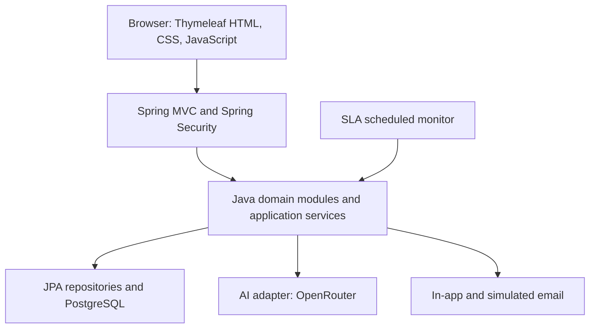

# Oops Project — Living Project Plan

Last updated: 2026-11-16 (Asia/Kolkata)

## 1. Purpose and working agreement

This file is the project's working source of truth for scope, decisions, implementation phases, progress, acceptance criteria, and submission readiness. It must evolve with the project; it is not a one-time proposal.

- Read this file before planning or implementing project work.
- Update it in the same work session whenever the user approves a decision, scope changes, a phase progresses, a blocker appears, or verification changes the known state.
- The user makes project decisions. Present options and consequences; do not silently select a stack, feature, business rule, or design. Record recommendations as proposals until approved.
- Approval to create this file is not approval of the proposed technology, scope, schedule, or implementation.
- Keep approved decisions distinct from requirements, proposals, and unresolved questions.
- Mark work complete only when its acceptance criteria have been verified. Record concrete evidence such as file paths, test results, or demo steps.
- Revise affected tasks, dependencies, acceptance criteria, and dates when a decision changes. Append a change-log entry and retain superseded decisions in the decision log.
- Keep this file synchronized with actual implementation and final documentation. Do not claim background or automatic updates outside active work sessions.

Status vocabulary: `NOT STARTED`, `IN PROGRESS`, `BLOCKED`, `READY FOR REVIEW`, `DONE`.

## Team handoff — current session, 16 November 2026

- Phases 1–2 scope/design gates approved. Team responsibilities, final report diagrams, model/budget and submission details remain deferred.
- Phase 3 verification: real PostgreSQL migrations, 15 foundation cases, role credential logins and role dashboard rendering pass. Existing employee account and saved incident survived both application and PostgreSQL process restarts. Desktop employee dashboard was visually inspected earlier; admin/technician, full-page and responsive visual checks remain outstanding. Do not describe Phase 3 as fully visually accepted.
- Phase 4 Steps 1–7 backend/form acceptance passed: catalog administration, report creation/detail access, calculated priority/snapshot/corrections, explicit lifecycle, ownership and role enforcement. Conversation privacy, linked replies and same-timestamp stale-edit checks now pass. Resolution/rejection/feedback and ordered history/transaction consistency checks pass; complete workflow restart acceptance and browser visual checks remain open.
- Latest full regression: **141 tests passed, zero failures/errors/skips** (`./mvnw -o test`, 16 November, 01:44 IST). Breakdown: foundation 15, catalog 6, workflow database/HTTP 36, view rendering 18, rules 56, committed audit/transaction consistency 10. These are automated checks, not browser screenshots.
- Actual runtime check: employee submitted labeled local ticket `INC-1` (Wi-Fi, Network, impact 2, urgency 2, criticality 3 → score 12/P2), then reopened it after app and database restarts with unchanged ownership/title/classification/priority. It remains CLASSIFIED because the persistent database has no eligible technician. This is a verification incident, not a seeded outage or completed technician demo.
- Local account inventory: active employee ID 1 is the runtime verification account. Documented demo role accounts are absent from this database; opt-in demo provisioning remains available. Passwords/keys are not recorded here.
- Migration mismatch resolved: V2 restored to its published contents; demo marker table is in V3. Both fresh databases and persistent restarts now validate V1–V4. Never edit an applied migration or repair checksums to conceal schema drift.
- Repository: https://github.com/Darshan-Bhandari/CSF213-OOPS-Project, `main`. Publish the current workflow source and its supporting modules together so a checkout can compile. Existing later-phase assignment/SLA/notification/reporting/AI scaffolding is included as dependencies; that does not mark Phases 5–6 fully accepted. Earlier Phase 3 ZIP is historical, not the latest source snapshot.
- Step 5 complete for backend/form checks: assigned technician can add private notes and public information requests; reporter replies link only to requests on the same ticket. Reads enforce actor authorization, employee views omit private note bodies, and internal notes do not trigger notifications. Request reply counts show awaiting/replied status without introducing a lifecycle state or pausing SLA clocks. Invalid and stale submissions retain message drafts with readable errors.
- V4 adds `conversation_revision` so every saved message makes the incident dirty and advances its optimistic version, including multiple writes at the exact same timestamp. V1–V3 remain unchanged. Fresh-database suite and existing-database upgrade pass; saved public reply on INC-1 survived app and PostgreSQL restarts with unchanged state/deadlines.
- Step 6 complete for backend/form checks: nonempty resolution details are persisted per cycle; only reporter (or reasoned admin override) can verify/close; reporter rejection starts a new cycle and retains previous resolution/SLA breach/first-response history and target snapshot. No eligible technician leaves it CLASSIFIED/unassigned. Invalid/stale action and feedback submissions retain drafts with readable errors; feedback is optional, reporter-only, rating 1–5 and once per incident after resolution. Closed incidents cannot be reopened through these actions.
- Step 7 complete for backend acceptance: incident history reads now enforce actor ownership/assignment/active role; global audit/email reads require an active administrator. Employee history excludes private investigation and generated AI suggestion events. New correction/reassignment/SLA/feedback/suggestion audit events use real lifecycle states; priority changes remain explicit in descriptions. Existing audit records are not rewritten.
- Ten committed-transaction tests verify ordered state reconstruction (including reassignment, system breaches, rejection and closure), mandatory audit transaction scope, rollback of partially written state/messages/resolutions/cycles/feedback/audits/notifications, and one-save/one-conflict for simultaneous same-version message submissions. Failure constraints run only in a separate isolated test database.
- Immediate next work: Step 8 complete employee-to-technician-to-closure workflow persistence across restarts and remaining visual checks. Repeated-report correlation is approved future scope below; it is not implemented. No live AI calls/model spending/public hosting approved.

## Approved addition — repeated reports indicating wider impact

User requests this feature be included, with implementation deferred while Phase 4 proceeds one step at a time. Correlate similar incidents from different reporters as possible shared problems; sufficient independent reports should raise the response priority. User delegates routine threshold choices and requests their justification. Do not claim this feature already exists.

Design work pending: matching evidence (service, category, symptom and time window), distinct-reporter counting, resistance to duplicate/spam reports, grouping uncertain matches, handling existing assignments/SLA snapshots, administrator correction, and auditable priority changes. Report frequency indicates broader impact; keep reported urgency and original inputs visible. The exact relationship to approved priority/SLA rules must be documented before implementation. Thresholds and matching rules will be chosen with concrete examples and rationale during that design task; no live AI is required or authorized. Track as planned follow-up after the core lifecycle; this addition supersedes earlier wording excluding duplicate/grouping features from scope.

Phase 4 Step 1 backend/form verification is complete: service/category create/edit/deactivate works; active administrator checks cover direct service mutations as well as protected HTTP routes; missing IDs and invalid inputs are rejected; duplicate names ignore case and surrounding spaces; audit entries use persisted IDs. Name comparison avoids near-identical catalog choices; display capitalization is retained. Deactivation retains records and prevents use in new incidents. Desktop admin visual inspection remains pending. Existing later workflow code is being reviewed rather than assumed complete.

Phase 4 Steps 2–4 backend/form verification is complete. Incident forms retain invalid submissions and show readable errors; detail/list/API access is scoped to reporter/assignee/admin; forged priority/state/reporter fields cannot change server-controlled values. Criticality is snapshotted; reasoned admin corrections audit old/new category, impact, urgency and score. Lifecycle edges are explicit and independent of enum order; wrong-role actions, invalid shortcuts, stale versions and closed-ticket reopening are rejected. All 27 priority combinations and all 64 lifecycle state pairs are checked. Full regression and live incident restart checks passed; visual acceptance remains separate.

Priority rationale: use the approved product of impact × urgency × criticality. P4 scores 1–2 cover low combined inputs; P3 3–7 covers moderate combinations; P2 8–17 captures multiple elevated inputs; P1 18–27 requires all inputs to be at least 2 with two at 3. This is a transparent project rule, not an empirically validated industry standard. Affected-user count is contextual and cannot multiply priority by itself. Future correlated-report escalation must preserve original factors and have separately documented rules.

## 2. Source and current state

- Authoritative requirements: `OOP_S1_2026-2027_Project.pdf`, 17 pages, CS F213/MAC F212 OOP, Semester I 2026–2027.
- Project: Intelligent IT Service Management & Incident Resolution System (I-ITSM).
- Hard submission deadline: **22 November 2026**. Exact cutoff time is not specified in the document.
- Required submissions: group PDF report, source repository link, and 15–20-minute recorded application demonstration involving every member.
- Current phase: Phase 4 — core incident workflow, `IN PROGRESS`; Steps 1–7 backend/form checks verified. Supporting Phase 5–6 code exists but those phase gates remain open. Phase 3 runtime checks pass with remaining visual limits recorded above. P01–P10 approved; team/submission administration deferred.
- Completed: all 17 pages reviewed; initial phase structure prepared; this living plan created at the user's request.
- Workspace inspected on 2026-11-14: only the source PDF existed before this file. No implementation or repository was present in this folder.
- Implementation status: foundation and Phase 4 Steps 1–7 backend/form checks pass; 141-test full suite and persistent incident restart check passed. Elevated execution resolved the earlier sandbox PostgreSQL restriction. Remaining phase acceptance and visual limits are in the team handoff above; model/budget and team allocation remain pending.
- Approved application format: web application (2026-11-15). Current stack is in section 4B; supporting tools approved in section 4C. Public hosting deferred; exact versions will be checked during foundation setup.

## 3. Requirements register

All items below are outstanding unless explicitly marked complete in later progress records. Examples in the PDF are not automatically adopted as implementation choices.

| ID | Requirement | Source pages | Planned phases | Verification |
|---|---|---|---|---|
| R01 | Employee, technician, administrator; authentication, authorization, role-specific GUI | 3–5, 13, 17 | 2–4, 7 | Each role can perform permitted actions and is denied forbidden actions |
| R02 | Employee registration/login, incident reporting/tracking, extra information, support responses, resolution viewing, feedback | 4 | 3–4, 7 | Employee workflow test |
| R03 | Technician assignments, acknowledgment, investigation notes, status updates, information requests, resolution, workload | 4 | 4–5, 7 | Technician workflow test |
| R04 | Admin user/technician/service/category/SLA/assignment management; incident, report, audit and violation monitoring | 4–5 | 3–6, 7 | Administration workflow and access tests |
| R05 | Create/view/update/assign/resolve/close incidents; store appropriate incident, investigation, resolution and closure information | 3, 5 | 4, 7 | End-to-end lifecycle and persistence tests |
| R06 | Extensible incident classification/categories | 5 | 2, 4 | Add a category without unrelated code redesign |
| R07 | Automatic priority using impact, urgency and business criticality; document algorithm and rationale | 3, 6 | 2, 4 | Known-input and boundary tests; report rationale |
| R08 | At least two interchangeable technician assignment strategies | 4, 6 | 2, 5 | Demonstrate both strategies and changing strategy |
| R09 | Applicable SLA, response/resolution deadlines and tracking, pre-deadline warnings, violation detection and recording | 4, 7 | 2, 5 | Controlled-time warning, response and resolution breach tests |
| R10 | Explicit lifecycle with invalid transitions rejected | 7 | 2, 4 | Valid lifecycle and invalid transition tests |
| R11 | At least two extensible notification mechanisms; real or simulated | 4, 8 | 2, 5 | Trigger and inspect both mechanisms |
| R12 | Complete incident history with timestamp, actor, action, incident, relevant previous/new state and description | 4, 8 | 4–7 | Reconstruct an incident from persisted history |
| R13 | At least five meaningful search/filter criteria and useful reporting/dashboard views | 4, 8–9 | 6–7 | Individual and combined filters; verify report totals |
| R14 | At least two intelligent/automated features; AI/ML optional | 4, 9–10 | 1–2, 6–7 | Feature-specific examples and false/edge cases |
| R15 | Encapsulation, abstraction, appropriate inheritance, polymorphism, interfaces, composition, association/aggregation, exceptions and collections | 10 | 2–7 | Code and UML evidence with design justification |
| R16 | At least two implemented and justified design patterns | 10–11 | 2–7 | Trace each pattern to actual code and behavior |
| R17 | Invalid login/input/operations/transitions, unavailable/overloaded technicians, missing services/SLAs, duplicates, database/network failures handled appropriately | 13 | 3–7 | Relevant exception and failure-path tests |
| R18 | Protected passwords, input validation, authentication, role authorization, secure API access where applicable, documented security | 13 | 2–7 | Security and permission tests; report limitations |
| R19 | Persist users, services, technicians, incidents, SLA policies, audit and resolution data | 13–14 | 2–7 | Restart and verify records/relationships |
| R20 | Problem analysis, stakeholders, challenges, proposed solution, explicit assumptions, functional/nonfunctional requirements and business rules | 14 | 1–2, 8 | Report checklist |
| R21 | Architecture diagram and UML use case/class diagrams showing required relationships and contracts | 14 | 2, 8 | Diagrams match final code |
| R22 | Technology inventory and justification, alternatives, advantages/limits, OOP support and scaling discussion | 12, 14 | 2, 8 | Answer all nine technology-selection questions |
| R23 | Source submitted through version-control repository; repository link supplied through course spreadsheet | 14 | 3, 8 | Reproducible checkout/setup and correct link |
| R24 | Database schema, important relationships, sample data and ER diagram where applicable | 14–15 | 2–3, 8 | Schema and diagram match implementation |
| R25 | At least 15 meaningful documented test cases: normal, boundary, invalid input, exceptions, authorization and business rules | 15 | 3–8 | Expected/actual results and passing evidence |
| R26 | At least three complete demonstrated workflows; 15–20-minute video; all members introduce themselves and explain modules | 15, 17 | 1, 7–8 | Timed rehearsal and final video checklist |
| R27 | Clearly identifiable member responsibilities and understanding of overall system | 15, 17 | 1, 8 | Responsibility allocation and walkthrough preparation |

Optional: innovation features, AI/ML, cloud hosting, real external notifications, containers, CI/CD, microservices, mobile support and other advanced technologies require explicit scope decisions. Do not let optional work undermine mandatory functionality or OOP quality.

Rubric reference (page 16): architecture 10, functionality 60, user experience 10, technical depth 15, testing 5, innovation 10, documentation/presentation 10; tentative total 120.

## 4. Decision log

| ID | Topic | Status | Decision / next action |
|---|---|---|---|
| D01 | Living plan | APPROVED — 2026-11-14 | User requested `plan.md` as the evolving project backbone |
| D02 | Team/group and responsibilities | PENDING | Obtain group number, members, skills, existing work and ownership |
| D03 | Application format | APPROVED — 2026-11-15 | Web application; core stack selected, hosting pending |
| D04 | Technology and database | APPROVED CORE STACK — 2026-11-15 | Latest screenshot selects Java, Spring Boot, Thymeleaf + HTML + CSS, JavaScript, PostgreSQL and OpenRouter. Earlier REST/Git/GitHub/Postman/modular-monolith baseline and supporting additions are recorded separately; the latest image does not settle their implementation details. See section 4B. |
| D05 | Scope and ambition | APPROVED — 2026-11-15 | All mandatory requirements, polished reference-based dashboard, two AI features; further enhancements need separate scope decisions |
| D06 | Organization and service catalog | APPROVED SETTING — 2026-11-15 | BITS campus IT support; seed services in section 4D approved |
| D07 | Intelligent features | APPROVED FEATURES — 2026-11-15 | Category suggestions and suggested resolutions through OpenRouter. Technicians review before acting. Model and budget pending; neither AI output automatically closes an incident nor changes a category without a permitted human action |
| D08 | Runtime, hosting and budget | APPROVED LOCAL-FIRST — 2026-11-15 | Build and demonstrate locally first; public hosting deferred. No paid-service spending authorized; user adds key/model later |
| D09 | Notifications | APPROVED — 2026-11-15 | In-app notifications and simulated email; no email credentials required |
| D10 | Interface direction | REFERENCE PROVIDED — 2026-11-15 | User supplied FyneDesk KPI dashboard image: light background, sidebar, teal accents, filters, metric cards, charts and tables. Exact role screens, branding and metrics remain pending; pictured menu items do not automatically enter scope. |
| D11 | Review cadence | CURRENT GATE — 2026-11-15 | Prepare concrete Phase 2 rules for user review, then implement approved decisions; ask again only for new material choices |
| D12 | Priority policy | APPROVED — 2026-11-15 | Multiplicative score and thresholds in section 4D |
| D13 | Assignment policies | APPROVED — 2026-11-15 | Skill-based and load-based strategies; eligibility, ties and capacity in section 4D |
| D14 | Lifecycle and permissions | APPROVED — 2026-11-15 | Controlled lifecycle, reporter verification, information requests and reopen behavior in section 4D |
| D15 | SLA policy | APPROVED — 2026-11-15 | PDF example targets, continuous elapsed time and 80% warnings; detailed rules in section 4D |
| D16 | OOP architecture and patterns | APPROVED — 2026-11-15 | Modular monolith with Strategy, State, notification composition and AI Adapter; diagrams/module tasks in section 4D |
| D17 | Accounts and security behavior | APPROVED — 2026-11-15 | Spring Security sessions; employee registration only; admin provisions privileged accounts; role/record permissions in section 4D |
| D18 | Reports and filters | APPROVED — 2026-11-15 | Eight filters and defined SLA/workload/resolution metrics in section 4D |
| D19 | Repository and submission details | PENDING | Provider, visibility, naming, upload links, extra professor instructions |
| D20 | Innovation credit | PENDING | Choose optional enhancement if desired; do not assume overlap with mandatory intelligence earns extra credit |
| D21 | Frontend | APPROVED; REVISED — 2026-11-15 | Thymeleaf + HTML + CSS for GUI, JavaScript for interactivity. Supersedes earlier HTML/CSS/JavaScript-only rendering choice; team familiarity with HTML/CSS/JavaScript remains recorded. React is not selected. |
| D22 | AI integration | APPROVED PROVIDER/FEATURES; KEY DEFERRED — 2026-11-15 | OpenRouter category and resolution suggestions. User adds key at the end. Model/budget pending; no credentials needed to begin |

## 4A. Earlier technology review — 2026-11-15

Historical review of the first stack screenshot. Section 4B supersedes its frontend/rendering and AI-provider choices. The supporting recommendations below remain proposals except where explicitly resolved in section 4B; this review does not authorize implementation.

| Component | User baseline | Review recommendation |
|---|---|---|
| Application | Web application | Keep |
| Backend language | Java | Keep; frontend also uses JavaScript |
| Backend framework | Spring Boot | Keep; use Spring MVC and keep business rules out of controllers |
| Frontend | HTML, CSS, JavaScript | CONFIRMED by user; team is comfortable with these technologies. Organize reusable JS modules, API handling and styles. |
| Database | PostgreSQL | Keep; use relational constraints, transactions and explicit schema migrations |
| Communication | REST APIs | Keep; validate requests and return consistent responses/errors |
| Version control | Git + GitHub | Keep; track source, migration scripts, test code and setup instructions |
| API testing | Postman | Keep for API exploration and collections; add automated business, security and persistence tests |
| Architecture | Modular monolith | Keep; one application with explicit domain modules and one database |

Historical supporting proposals: the six-tool approval in section 4C now approves Spring Security, JPA/Hibernate, Flyway, Maven and JUnit/Spring testing. Other detailed behaviors below remain proposed unless approved elsewhere:

- Spring Security with server-side sessions and protected cookies for the browser application; CSRF protection for cookie-authenticated writes, password hashing and backend role/record-level authorization. Sessions simplify logout but require a session-sharing decision if scaling to multiple servers.
- Earlier proposal to serve a static frontend and REST endpoints: superseded for primary page rendering by the user's Thymeleaf selection. Same-application deployment and selective JSON endpoints remain design proposals; REST does not require a separately deployed frontend or JWT.
- Spring Data JPA/Hibernate for persistence: less repetitive repository code, but mappings, transactions, lazy loading and query performance must be understood. Use explicit response/request DTOs to avoid exposing entities and sensitive fields.
- Flyway for versioned SQL migrations and Maven Wrapper for repeatable builds. Both add small setup/learning costs; migrations prevent divergent schemas and the wrapper standardizes the build tool. Pin a compatible stable JDK/framework/dependency set during setup, after checking the environment.
- JUnit Jupiter, Mockito where useful, and Spring Boot/MockMvc integration tests alongside Postman. Verify important persistence behavior against PostgreSQL. Testcontainers is optional if Docker is available; an isolated PostgreSQL test database is another option.
- Spring scheduling for SLA scans in the initial single-instance application. Persist absolute deadlines and violation/warning records; scan overdue items after restart, avoid duplicate events, and inject a controllable clock for tests. In-process scheduling does not execute while the application is stopped; multi-instance coordination is a later design concern.
- Earlier HTML/CSS/JavaScript-only frontend choice: revised by section 4B to include Thymeleaf. Styling/component or chart libraries remain optional and require a separate decision.

Architecture review requirements:

- Domain modules may include identity, service catalog, incidents, assignment, SLA, notifications, audit and reporting. Exact boundaries await approval.
- Demonstrate explicit OOP behavior: interchangeable assignment strategy implementations, notification contracts, and guarded incident transitions. Framework annotations and CRUD repositories alone do not satisfy the design intent.
- Keep incident changes and required audit records transactionally consistent; prevent concurrent updates from silently overwriting each other. External notification failure should not erase a successfully recorded incident.
- Avoid unnecessary infrastructure (microservices, message brokers, extra backend languages) without a concrete approved requirement.
- Design a reproducible demo setup: migrated PostgreSQL database, seeded role accounts, locally available assets, controlled SLA demonstration data and tested restart instructions. Public hosting remains undecided.

Phase impact: Phase 2 settles the security/rendering/persistence/test choices; Phase 3 establishes them and a vertical login-to-database check; Phases 4–6 implement domain behavior with tests; Phase 7 checks full workflows and persistence/concurrency; Phase 8 documents the actual architecture and prepares repeatable demonstrations.

Evidence checked against official documentation on 2026-11-15:

- Spring MVC/static resources: https://docs.spring.io/spring-boot/reference/web/servlet.html
- Spring Security: https://docs.spring.io/spring-security/reference/servlet/authentication/session-management.html and https://docs.spring.io/spring-security/reference/servlet/exploits/csrf.html
- JPA: https://spring.io/guides/gs/accessing-data-jpa/
- Migrations: https://docs.spring.io/spring-boot/how-to/data-initialization.html
- Testing: https://docs.spring.io/spring-boot/reference/testing/spring-boot-applications.html
- Scheduling: https://spring.io/guides/gs/scheduling-tasks
- Relational constraints: https://www.postgresql.org/docs/current/ddl-constraints.html

## 4B. Current selected stack and visual reference — 2026-11-15

The user's latest stack screenshot is the current technology decision. It supersedes the earlier frontend-only selection and adds an AI provider.

| Component | Selected technology | Role |
|---|---|---|
| Application | Web application | Browser-based interface |
| OOP programming | Java | Domain objects, rules and patterns |
| GUI | Thymeleaf + HTML + CSS | Server-rendered page templates and styling |
| Interactivity | JavaScript | Interactive controls and browser behavior |
| Backend | Spring Boot | Application logic and HTTP request handling |
| Database | PostgreSQL | Persistent application data |
| AI integration | OpenRouter | Provider integration for selected AI features; specific model not selected |

Design implications to resolve in Phase 2:

- Use Thymeleaf page templates and shared fragments for the GUI. Determine form routes and any JavaScript/JSON endpoints from the actual workflows; do not assume every screen requires a separate REST call.
- Preserve the earlier REST APIs, Git/GitHub, Postman and modular-monolith baseline in the decision history. Confirm how these fit the detailed architecture; no repository, public hosting or external service setup has been performed.
- User-authorized AI integration: build a backend adapter with externally configured API key and model. The user will enter their own key at the end; development must not require a live key. Credentials must not be placed in browser assets or the source repository. Supporting dependencies and feature-level business behavior remain subject to the design decisions.
- Without a configured key, the application must still start and support non-AI workflows. Report AI as unavailable rather than displaying fabricated model output. Use an explicit test double for automated tests, clearly separate from real provider calls.
- Prepare an example configuration and exact local startup instructions during implementation. A sample environment file is only a template unless an explicit loading mechanism is implemented. Test adapter success/failure with controlled responses; live OpenRouter verification remains outstanding until the user adds a key and selects a model. Do not mark AI integration fully verified based only on mock tests.
- Subsequent approval selects category suggestions and suggested resolutions with technician review (section 4C). Model/budget remain pending; failure/invalid-response behavior approved in section 4D.
- Spring Security, JPA/Hibernate, Flyway, Maven and JUnit/Spring testing subsequently approved in section 4C. Scheduling details and behavior approved in section 4D.

Visual reference: user-supplied FyneDesk KPI dashboard image. Record the visible sidebar, light layout, teal accents, metric cards, filter controls, charts and tabular reporting as reference characteristics. The screenshot does not approve the product name, every displayed metric, or extra modules such as asset/change/request management. Role-specific screens and final styling require the user's decisions.

## 4C. Approved scope package — 2026-11-15

User response **"all approved"** approves the six choices in the immediately preceding proposal:

| Choice | Approved result |
|---|---|
| Organization | BITS campus IT support: Wi-Fi, campus login, lab computers, email and related IT services |
| Scope | All mandatory requirements plus polished dashboard based on the supplied reference and two AI features |
| AI features | Category suggestions and suggested resolutions; technicians review suggestions before acting |
| Notifications | In-app notifications plus simulated email |
| Runtime | Local-first build and demonstration; public hosting decided later |
| Supporting tools | Spring Security, Spring Data JPA/Hibernate, Flyway, Maven and JUnit/Spring testing |

This six-choice approval initially left numerical/workflow/schema choices open; the subsequent Phase 2 approval accepted section 4D. No need to ask again about these six settled choices. Member names/group number and credentials can come later. Environment inspected: Oracle JDK 25.0.1 and Temurin 25 are installed; build dependencies/database availability and compatible stable versions still need setup checks.

## 4D. Approved Phase 2 executable design — 2026-11-15

User approved P01–P10 with "all approved" after reviewing the Phase 2 proposal. D12–D18 are closed and Phases 3–6 implementation is authorized against these rules. Provider/model spending and public deployment remain excluded.

### Architecture and responsibilities

One modular Spring Boot application serves Thymeleaf pages, CSS/JavaScript, form submissions and selective JSON endpoints. PostgreSQL is the persistent store. Domain rules remain in Java services/domain objects; controllers validate/translate requests. Modules: identity, catalog, incidents, assignment, SLA, notifications, audit, AI and reporting. Modules collaborate through services/contracts rather than reaching directly into another module's repositories.

Suggested source layout: `src/main/java/.../{identity,catalog,incident,assignment,sla,notification,audit,ai,reporting}`; `src/main/resources/templates/{fragments,employee,technician,admin}`; `static/{css,js}`; `db/migration`; corresponding Java tests. Maven manages a compatible stable Spring Boot dependency set; pin versions during setup after environment verification. No separate frontend build tool, microservices, broker or required Docker installation.

### P01 — Accounts, screens and permissions

- Roles: EMPLOYEE, TECHNICIAN, ADMIN. Employee registration is allowed; public registration cannot select a privileged role. Admin creates/deactivates technicians/admins and manages users. Demo accounts are seeded only in the demo environment. Deactivation preserves incident/audit history.
- Use protected session cookies and CSRF-protected mutations; hash passwords. Check both role and incident ownership/assignment on the backend. Administrator permissions do not eliminate required lifecycle guards.
- Employee: own incidents, public conversation, information requests, resolution, verification, rating/feedback. Cannot see internal investigation notes, unrelated tickets or technician-only AI suggestions.
- Technician: assigned incidents, own workload, internal notes, public replies, information requests, resolve actions and AI suggestions. Cannot alter another technician's incident or close on behalf of the reporter.
- Administrator: incidents/reports/audit/configuration/users, reassignment and category/service/priority-input correction. Audited override reason required for reassignment or business-input correction; no arbitrary priority value outside the algorithm.
- Screens: shared login/register, sidebar and notifications; employee dashboard/list/create/detail; technician dashboard/queue/detail; admin overview/incidents/users/technicians/services/categories/SLA/assignment/reports/audit/simulated-email log. Product name remains a neutral placeholder until supplied.

### P02 — Catalog, priority and classification

Approved seed services: campus Wi-Fi (criticality 3), campus login (3), campus email (2), lab computers (2), printers (1). Service criticality is admin-configurable. Seed categories: Network, Authentication, Hardware, Software, Email and Other; categories/skills are records, not hard-coded class hierarchies.

Priority score = impact × urgency × service business criticality. Each factor is an integer 1–3. Impact: one user=1, multiple users/group=2, campus-wide/major service interruption=3; urgency: workaround available=1, serious impairment=2, work blocked/time-critical=3. Reporter supplies initial impact/urgency and affected-user count; count is contextual, not an additional multiplier. Admin can correct inputs with a reason. Snapshot criticality on incident creation; changing catalog values must not silently rewrite historical priority.

| Score | Priority |
|---|---|
| 18–27 | P1 Critical |
| 8–17 | P2 High |
| 3–7 | P3 Medium |
| 1–2 | P4 Low |

Store score and factors so the UI/report can explain the result. Employee chooses an initial category (including Other). Technician/admin may accept an AI category suggestion and correct it; never automatically change assignment or category from a model response. A correction that makes an assignee ineligible requires administrator reassignment. Tests cover all 27 possible input combinations and threshold boundaries.

### P03 — Two assignment strategies

Common eligibility: active technician, available=true, required category skill present, active workload below configurable capacity (approved default 5). Active workload counts all assigned incidents except RESOLVED/VERIFIED/CLOSED. No eligible technician: leave CLASSIFIED/unassigned, notify administrator and continue SLA tracking. Never bypass skills merely to fill an assignment.

1. Skill-based: highest proficiency for the incident category (1–3), then lowest workload, then stable technician ID.
2. Load-based: lowest active workload among eligible technicians, then highest category proficiency, then stable technician ID.

Administrator selects global default strategy and may manually reassign to an eligible technician with reason. Existing assignments do not change when the default strategy changes. Assignment is transactionally protected so concurrent requests cannot exceed capacity. Automated assignment runs once after classification; failed assignments can be retried by administrator. Reassignment requires fresh acknowledgment but does not reset elapsed response targets or erase previous acknowledgment history.

### P04 — Lifecycle, investigation and closure

Proposed lifecycle: NEW → CLASSIFIED → ASSIGNED → ACKNOWLEDGED → IN_PROGRESS → RESOLVED → VERIFIED → CLOSED. Creation/classification/initial assignment may occur in one request but produce separate audit events. Failed assignment leaves CLASSIFIED. Only the assigned technician can acknowledge, start investigation or resolve; resolution requires nonempty details. Invalid shortcuts (e.g. NEW → CLOSED) fail on the backend.

Information requests/public replies are conversation records; technician-only investigation notes are explicitly internal. Requesting information does not pause the SLA or introduce another state in the initial scope. Reporter verifies resolution (RESOLVED → VERIFIED) and closes (VERIFIED → CLOSED); a single confirm-and-close action may execute both with separate history events. Feedback is optional, rating 1–5 plus comment, only after resolution by the reporter.

Reporter can reject a RESOLVED solution with reason, returning the incident to CLASSIFIED for re-evaluation/reassignment. Audit rejection and reclassification; preserve prior resolutions and SLA breaches. Start a new resolution cycle under the original SLA snapshot at rejection time, while retaining first-response/completed-cycle history. No reopening after CLOSED in initial scope; a new incident can reference the old one. Admin can perform reporter verification/closure only with an explicit reason, for demo/support continuity.

### P05 — SLA calculation, warnings and monitoring

Use the PDF's example as initial configurable policy, elapsed 24/7 time, no business calendar or waiting pause:

| Priority | Response target | Resolution target |
|---|---|---|
| P1 | 5 minutes | 30 minutes |
| P2 | 15 minutes | 2 hours |
| P3 | 1 hour | 8 hours |
| P4 | 4 hours | 24 hours |

Per-service overrides may replace a priority's default targets. Snapshot chosen policy/targets on creation. First acknowledgment meets response target; a resolution meets the current resolution-cycle target. Creation is the anchor for initial deadlines. Success at the exact deadline counts as on time. Breach condition: no qualifying completion at/before the deadline and current time is strictly later. At 80% of each target, create one warning if still pending; if already breached on the first scan, create only the breach event. Keep response/resolution events separate.

Persist deadlines, acknowledgments, resolution cycles and breach/warning records. Scan every 30 seconds while running and on startup; browser polling is not the authoritative SLA check. Late completions still show recorded violations. Deduplicate monitor events in the database. Inject a Java Clock for deterministic tests. Store times as UTC instants and show Asia/Kolkata labels in the demo.

Admin reprioritization before completion recalculates the pending targets from the original cycle start using the newly selected policy; elapsed time does not reset and existing breach records remain. Policy edits otherwise affect new incidents only. Missing SLA/service blocks incident creation with a clear error instead of creating an untrackable incident. Seed short-target demo incidents in a labelled demo profile; never change production rules to accelerate a video.

### P06 — Notifications, audit and consistency

Two NotificationChannel implementations: persisted in-app messages and persisted simulated-email deliveries with recipient/subject/body/status shown to admin. Simulation is explicitly labelled; no actual email is sent. Trigger on creation, assignment/reassignment, priority change, information request/reply, SLA warning/breach, resolution and closure, with recipients limited to relevant reporter/assignee/admin.

Required incident/audit/notification-record writes share a transaction. Audit records capture actor (including SYSTEM), time, incident, action, old/new values and reason; do not allow UI edits/deletion of audit history. Notification failures must not silently drop records. Keep audit data and no hard-delete of referenced catalog/users. Concurrent stale incident edits return conflict rather than overwriting newer data.

### P07 — AI suggestions and safe failure

AI advisor contract with an OpenRouter implementation. Category suggestion chooses only among active categories; server validates returned category ID. Resolution suggestion uses description, service/category and relevant completed resolution examples, bounded to a small selection. Clearly distinguish retrieved historical facts from model-generated advice. AI is advisory: assigned technician/admin previews and explicitly applies eligible suggestions; an accepted resolution suggestion is an editable draft, never automatic execution/resolution/closure.

Configurable key and model; both absent means unavailable, not startup failure. Backend-only requests with timeout, validated/length-limited outputs, safe rendering, no credentials in browser/logs. Provider failure/invalid output returns a clear unavailable response while CRUD continues. No automatic retry loop or paid calls without user-supplied configuration. Simulated AI responses only in tests, not represented as live AI in the demo. Key/model activation and one real-call verification are deferred to the user; provider/model budget selection is a separate decision.

### P08 — Database and OOP evidence

Proposed persistence entities: UserAccount, TechnicianProfile, Category, TechnicianSkill, ITService, SlaPolicy, Incident, InvestigationNote, ConversationMessage, InformationRequest, ResolutionRecord, ResolutionCycle, Feedback, AuditEntry, Notification, SlaEvent, AssignmentConfiguration and AiSuggestion. Use foreign keys, required fields, uniqueness constraints, length/range validation and indexed incident filters. Store Incident version for optimistic conflict detection; guard capacity updates with appropriate transaction/locking. Avoid serializing entities as public responses.

Relationships: UserAccount has optional TechnicianProfile; TechnicianProfile has many TechnicianSkills linking categories; Incident associates reporter, service, category, assignee and policy snapshot; Incident owns notes/conversation/resolution cycles and feedback. Retain immutable history when records are deactivated.

OOP: Incident methods enforce transitions and encapsulated fields; AssignmentStrategy provides polymorphism with SkillBasedAssignment and LoadBasedAssignment; IncidentState implementations provide State pattern guards; NotificationChannel composes two channels. Abstract BaseNotificationChannel with shared delivery-record behavior and concrete in-app/simulated-email subclasses provides justified is-a inheritance. AiAdvisor with OpenRouter adapter isolates the provider. Repositories separate storage. Avoid artificial inheritance for categories or forcing account roles into incompatible entity subclasses.

Use case diagram specification: Employee reports/views/replies/verifies/closes/rates own incident; Technician acknowledges/investigates/requests info/views AI/resolves assigned incident; Admin manages accounts/catalog/SLA/assignment, reassigns and reports/audits; SYSTEM calculates priority/assigns/monitors/notifies. Produce final UML and ER diagrams alongside implemented classes/schema, using this specification.

### P09 — Search and metric definitions

Eight incident criteria: ID/text, created-date range, status, priority, category, service, technician and SLA status. Combine filters with AND, paginate and enforce role visibility before filtering/aggregation.

Dashboard metrics: total incidents; open backlog (all except RESOLVED/VERIFIED/CLOSED); critical backlog (P1 within backlog); current resolved/verified count; closed count; incidents with any recorded SLA breach; average first response (acknowledged incidents in selected creation cohort); average first resolution (incidents with a first resolution in cohort). Show sample sizes and N/A for no samples. SLA compliance denominator is incidents whose first resolution cycle completed or whose relevant initial target has already expired; incidents with any first-cycle breach fail compliance. Reopened-cycle violations are shown separately and in any-breach totals. Technician workload counts active assigned incidents as defined in P03: exclude RESOLVED, VERIFIED and CLOSED. Service/category counts and workload tables come from persisted data, never hard-coded screenshot numbers.

### P10 — Approved implementation backlog and demonstrations

| Phase | Concrete tasks | Verification |
|---|---|---|
| 3 | Check Maven/PostgreSQL and compatible versions; create pom/wrapper, configuration templates, migrations, security, role accounts and Thymeleaf fragments | Build; migrations; login/logout/CSRF; unauthorized access; restart |
| 4 | Catalog/admin forms; incident domain/state services, notes/conversation, priority and audit; role-specific list/detail/action pages | Full lifecycle; validation; ownership; invalid transitions; feedback |
| 5 | AssignmentStrategy implementations/config UI; SLA Clock/monitor/policies; two notification channels and history | Different strategy outcomes; no-match/capacity; deadline boundaries; restart catch-up; deduplication |
| 6 | OpenRouter adapter and two advisor actions; filters, paginated tables, reports/metric cards/charts | Missing-key mode, mocked provider errors, valid/invalid suggestions; accurate filters and aggregates |
| 7 | At least 20 documented meaningful cases spanning permissions, boundaries, rules, concurrency and persistence; fix defects | Repeatable automated suite plus three browser workflows; live AI check separately |
| 8 | Final report/UML/ER/schema/stack rationale, setup instructions and member script; timed recording and submission | 15–20 minutes; all members; 3 complete workflows; links/files verified |

Demo 1: employee reports campus Wi-Fi outage → priority/SLA computed → assignment → both notification mechanisms → technician acknowledgment.
Demo 2: technician investigates/requests information → employee replies → technician previews/applies AI category/resolution suggestion → resolves → employee verifies/closes/gives feedback → complete audit. Requires live key/model to claim AI demonstration.
Demo 3: administrator switches assignment strategy on new sample incidents with deliberately different proficiency/load → demonstrates unassigned fallback and SLA warning/breach via labelled short-target demo configuration → filters/report totals and history. Do not invent duplicate detection/escalation features beyond approved scope.

Minimum test catalog: priority combinations; invalid factor; unauthorized privilege registration; wrong-role action; cross-reporter read; unassigned-technician write; invalid state shortcut; empty resolution; category correction/skill eligibility; strategy differences/ties; capacity/no-match; response/resolution exact deadlines; warning/breach deduplication; restart catch-up; policy snapshot/reprioritization; rejection/re-resolution; stale edit conflict; rollback/audit consistency; disabled key; malformed/timeout AI; accepted-suggestion authorization; filters/metrics; persistence across restart. Selected cases now executed; see team handoff and `docs/testing.md` for exact coverage. Remaining cases must still be verified.

Deferred nonblocking administration: member names/group number/ownership allocation, repository destination/visibility, final branding, course upload links and filename-year discrepancy. Live AI key/model and spending decisions are required before real provider requests, not before foundation development.

## 5. Execution phases

### Phase 1 — Requirements and scope

Status: DONE for scope/design gate. Team responsibilities remain deferred until documentation/recording and are not a build blocker.

- [x] Read the complete project document.
- [x] Extract mandatory requirements, deliverables and constraints.
- [x] Create this living plan.
- [x] Confirm application format: web application.
- [x] Resolve build-blocking first-round scope choices in section 4C.
- [x] Approve scope and distinguish optional enhancements.
- [x] Draft three complete demo workflows aligned to selected features (P10; approved).
- [ ] Assign member responsibilities before report/recording; deferred, not a build blocker.

Outputs: approved scope, requirements coverage, team responsibilities, demo outlines and decision log.
Exit: no unresolved scope choice blocks architecture; user approves scope.

### Phase 2 — Technology and system design

Status: DONE for design gate. P01–P10 approved. Final rendered UML/ER diagrams will be reconciled with implementation during documentation.

- [x] Compare candidate stacks and document advantages, limitations and alternatives (sections 4A–4C).
- [x] Confirm core technologies: Java, Spring Boot and PostgreSQL (D04).
- [x] Confirm GUI: Thymeleaf + HTML + CSS, with JavaScript interactivity (D21).
- [x] Confirm AI provider: OpenRouter (D22).
- [ ] Finalize runtime, architecture, supporting dependencies and exact versions.
- [ ] Select AI model/features, budget, output handling and fallback behavior.
- [ ] Approve role-specific screens based on the provided dashboard reference.
- [x] Draft domain objects, contracts, responsibilities and relationships (P08; approved).
- [ ] Approve lifecycle, permissions, priority, assignment and SLA rules.
- [ ] Select and justify at least two design patterns and appropriate inheritance.
- [x] Draft architecture and use case/class/database specifications (P01/P08); final UML/ER artifacts will follow implemented design.
- [ ] Define endpoints or equivalent application interfaces, validation and errors.
- [x] Draft feature-specific acceptance tests and security/nonfunctional expectations (P01–P10; approved, execution tracked separately).

Outputs: approved architecture/design, schema, business rules and implementation backlog with concrete modules/files once the stack is known.
Exit: design covers R01–R27; user approves proposed technical and business decisions.

### Phase 3 — Project foundation

Status: IN PROGRESS. Dependencies: Phase 2 approved.

- [x] Create approved project structure, dependency declarations, Thymeleaf templates/static assets and configuration. Compilation tracked separately.
- [x] Establish version control: GitHub repository `Darshan-Bhandari/CSF213-OOPS-Project`, branch `main`; initial upload verified at `ee79ea2`. Later local edits remain uncommitted.
- [x] Write V1 foundation migration and repeatable opt-in demo accounts; runtime migration verification pending.
- [x] Implement authentication, protected password storage and authorization; test execution pending.
- [x] Add role-specific navigation and account administration foundation; render verification pending.
- [x] Add 15 PostgreSQL integration tests, local database helper, configuration template and README startup instructions.
- [x] Verify compilation: Maven test-compile succeeded for 18 application classes and 2 test/helper classes targeting Java 21 on JDK 25.0.1. Maven Wrapper 3.3.4 / Maven 3.9.11 verified.
- [ ] Verify migration execution, login/logout/CSRF/role tests, restart persistence and rendered pages before marking Phase 3 DONE.

Exit: reproducible startup, persistent sample accounts, all roles can log in, unauthorized access is rejected.

### Phase 4 — Core incident workflow

Status: IN PROGRESS. Steps 1–7 backend/form checks passed; complete workflow restart acceptance and visual inspection remain. Remaining Phase 3 role visual checks are recorded separately; approved lifecycle/priority/visibility rules apply.

- [x] Implement service/category administration and extensible classification. Verified add/edit/deactivate, case-insensitive duplicate handling, input validation, backend/HTTP authorization, CSRF and persisted audit subjects in `CatalogIntegrationTest` (6 cases). Admin visual inspection is tracked separately.
- [x] Implement incident creation, detail viewing and permitted updates. Validated form, retained invalid input, owner/assignee/admin visibility, protected API and reasoned admin corrections verified by HTTP/database tests.
- [x] Implement priority calculation and input validation. All 27 valid combinations, invalid factor bounds, server-controlled factors, criticality snapshot and reasoned correction audit verified.
- [x] Enforce lifecycle transitions and ownership/role rules. All 64 state pairs checked; credential-based role logins and complete HTTP lifecycle pass; wrong role, stale edit, invalid shortcuts and reopening CLOSED rejected.
- [x] Implement investigation, notes, information requests and employee replies. Verified private note visibility/no notification, own-ticket request links and reply counts, draft retention, validation/CSRF/ownership, unchanged SLA/state, same-timestamp optimistic versions and persistent public reply after full restart.
- [x] Implement resolution, verification/closure and feedback per approved rules. Verified valid/invalid details and reasons, reporter/admin/technician permissions, separate verification then closure and combined closure, rejection/re-resolution with retained records/SLA snapshot/breaches, no-match fallback, stale drafts, optional reporter feedback with rating bounds and duplicate prevention.
- [x] Persist audit events with each important mutation from the start. Verified ordered reconstruction and actor/state/incident/time/context fields, protected history reads, MANDATORY audit transactions and true commit/rollback under injected database failures and concurrent stale edits (`AuditConsistencyIntegrationTest`, 10 cases).
- [ ] Verify complete lifecycle and data survival across restart.

Exit: employee-to-technician-to-closure workflow works with complete persisted history and invalid transitions rejected.

### Phase 5 — Assignment, SLAs and notifications

Status: NOT STARTED. Dependencies: Phase 4 and D09/D13/D15.

- [ ] Implement two interchangeable assignment strategies and selection/configuration.
- [ ] Handle availability, workload limits, ties and no eligible technician.
- [ ] Implement applicable SLA selection and response/resolution deadlines.
- [ ] Implement monitoring, warnings and durable violation recording.
- [ ] Implement two notification mechanisms behind extensible contracts.
- [ ] Verify event triggers, recipients and avoidance of repeated warning/violation spam.
- [ ] Prepare deterministic time-based demo/test scenarios without misrepresenting real production timing.

Exit: both strategies, SLA warnings/breaches and both notification channels are independently demonstrable and tested.

### Phase 6 — Intelligence and reporting

Status: NOT STARTED. Dependencies: core data and approved D07/D18/D20.

- [ ] Build OpenRouter integration for the approved AI feature(s), with configurable key/model, validation and failure handling; user adds their own key at the end. Do not choose a model or spend budget implicitly.
- [ ] Verify startup and non-AI workflows with the key absent; clearly identify unavailable AI and test controlled success/failure responses.
- [ ] After user configuration, verify a real AI request separately from mock tests and document its outcome.
- [ ] Implement selected intelligent feature 1; document behavior and limitations.
- [ ] Implement selected intelligent feature 2; document behavior and limitations.
- [ ] Implement at least five approved search/filter criteria and combined filtering.
- [ ] Implement agreed dashboards/reports with precise metric definitions.
- [ ] Implement optional innovation only if approved and core scope remains achievable.
- [ ] Add realistic positive, negative and boundary sample scenarios.

Exit: two intelligent features and required filters work; dashboard values match underlying data.

### Phase 7 — Verification and stabilization

Status: NOT STARTED. Dependencies: Phases 3–6; tests also developed during those phases.

- [ ] Maintain at least 15 meaningful documented cases with inputs, expected result, actual result and evidence.
- [ ] Cover normal flows, boundaries, invalid input, exceptions, permissions and business rules.
- [ ] Verify missing SLA/service, unavailable/overloaded technicians, duplicate behavior and relevant database/network failures.
- [ ] Verify audit completeness, persistence, assignment behavior and SLA timing.
- [ ] Run all three end-to-end demonstration workflows from repeatable seed data.
- [ ] Fix failures, rerun affected checks and record residual limitations honestly.
- [ ] Reconcile implementation against every requirement in section 3.

Exit: acceptance checks pass, at least 15 documented tests pass, no unresolved mandatory-feature blocker remains.

### Phase 8 — Report, recording and submission

Status: NOT STARTED. Dependencies: verified application; documentation drafted throughout earlier phases.

- [ ] Finalize problem analysis, stakeholders, assumptions and requirements.
- [ ] Synchronize architecture, UML, schema/ER diagram and technology inventory with actual code.
- [ ] Explain algorithms, patterns, OOP evidence, security, scaling, alternatives and limitations.
- [ ] Include test cases/results and database sample data.
- [ ] Generate and visually review the final group PDF report.
- [ ] Verify repository setup instructions from a clean checkout where feasible.
- [ ] Prepare a 15–20-minute demo script containing three complete workflows and all member sections.
- [ ] Rehearse; each member introduces themselves and explains their modules in the recording.
- [ ] Confirm filename-year discrepancy, group number, submission links and exact cutoff if provided.
- [ ] Check final report/video and repository link; submit through authorized course destinations.
- [ ] Record actual submission confirmation; do not mark submitted based only on local file creation.

Exit: complete report, reproducible source, finished compliant recording and verified submission.

Human participation: the assistant can implement, test, prepare diagrams/report/demo data and script, and assist recording setup. Team members must supply identities/responsibilities, make project decisions, and participate in the recorded presentation. Access-dependent uploads require the appropriate destination and authorization.

## 6. Questions awaiting the user

First round:

1. Group number, number of members, skills, existing work and responsibilities?
2. ANSWERED — Web application (2026-11-15; D03).
3. ANSWERED — Core stack plus Spring Security, JPA/Hibernate, Flyway, Maven and JUnit/Spring testing approved. Compatible exact versions checked during setup.
4. ANSWERED — Mandatory completeness, polished dashboard and two AI features.
5. ANSWERED — BITS campus IT support.
6. FEATURES ANSWERED — Category and resolution suggestions, reviewed by technicians. Key added later; model and budget pending before live calls.
7. RUNTIME ANSWERED — Local first, public hosting deferred; no spending approved.
8. CHANNELS ANSWERED — In-app plus simulated email; polished reference-based dashboard approved. Detailed screens approved in P01.
9. Pause after each phase or execute the approved plan and return for new decisions?
10. Additional professor instructions, templates, links, naming corrections or interim deadlines?

P01–P10 (D12–D18) approved. Exact AI model/budget and deferred administration are not foundation blockers. Ask only about new material decisions.

## 7. Proposed schedule — not yet approved

| Date, November 2026 | Proposed target |
|---|---|
| 14 | Decisions, scope and design |
| 15 | Foundation and authentication |
| 16–17 | Core incident workflow |
| 18 | Assignment, SLA and notifications |
| 19 | Intelligence and reporting |
| 20 | Testing and fixes |
| 21 | Report completion and rehearsal/recording |
| 22 | Submission buffer and final verification |

As of 15 November, scope/design gates for Phases 1–2 are approved; Phase 3 runtime acceptance remains outstanding. Re-estimate remaining implementation after runtime verification. Dates are targets, not promises. Preserve recording and submission buffer when adjusting scope.

## 8. Risks, ambiguities and blockers

| Item | Current state / action |
|---|---|
| Detailed business rules | P01–P10 approved; implement against recorded policies |
| Build environment | Normal Maven Java network resolution denied. Offline official-dependency cache allowed successful application/test compilation. PostgreSQL initdb denied shared-memory allocation before test bodies ran; no integration tests passed. Native Apple Silicon binary profile added. Git initialization and push succeeded using permitted elevated Git operations. Elevated runtime execution also starts PostgreSQL and loopback sockets successfully; 15 foundation tests passed. Restart is now blocked by a migration checksum mismatch while local files are being edited. |
| Short deadline | Eight calendar days from initial planning; prioritize mandatory functionality and protect final-day buffer |
| Video filename | PDF's example uses `1_OOP_S1_2025-2026_Project` despite 2026–2027 course year; seek clarification before final naming |
| Submission destinations | Shared-folder and spreadsheet links not supplied in the PDF |
| Submission cutoff | Date given, exact time unspecified; obtain course instructions if available |
| Intelligence/innovation overlap | Do not promise bonus credit for merely fulfilling mandatory features |
| Team and recording | Member allocation and recording availability unknown |
| Service integrations | Budget, credentials and network availability undecided; select behavior explicitly |

## 9. Progress and evidence

| Date | Completed work | Evidence / limitation |
|---|---|---|
| 2026-11-14 | Requirements review | All 17 source pages read; extracted requirements captured above |
| 2026-11-14 | Living plan established | `plan.md`; provisional phases and pending decisions preserved |
| 2026-11-15 | Application format selected | User explicitly chose web application; D03 approved |
| 2026-11-15 | Updated core stack and dashboard reference recorded | Latest screenshots select Thymeleaf and OpenRouter; sections 4B and D21/D22 supersede earlier choices |
| 2026-11-15 | Added root `AGENTS.md` for Codex project workflow | User asked to begin using Codex to automate project work; instructions preserve approved scope and verified status |

Next action: implement and verify Phase 3 foundation, then proceed to approved incident workflows. No need to reapprove settled scope/tools/business rules; credentials, model and team details can be provided later.

## 10. Change log

| Date | Change | Basis |
|---|---|---|
| 2026-11-14 | Created initial living plan with requirements, phase checklists, decision register, schedule, risks and completion criteria | User explicitly requested an evolving `plan.md` project backbone |
| 2026-11-15 | Approved web application format; updated current state, Phase 1 checklist, questions and schedule status | User selection: "web application" |
| 2026-11-15 | Recorded user-selected baseline stack and end-to-end review; supporting choices remain proposals | User supplied stack screenshot and requested critical analysis |
| 2026-11-15 | Confirmed HTML/CSS/JavaScript frontend and team familiarity; closed frontend alternatives | Explicit user decision |
| 2026-11-15 | Revised GUI to Thymeleaf + HTML + CSS with JavaScript; confirmed Java/Spring Boot/PostgreSQL and OpenRouter; recorded dashboard reference and updated dependent phase tasks | User supplied latest stack and reference images; earlier frontend choice superseded |
| 2026-11-15 | Authorized building OpenRouter integration with deferred user-entered API key; added missing-key behavior and separate live verification criteria | User: "u make it in the end we will copy paste a key ourselfs" |
| 2026-11-15 | Approved all six scope/tool choices and prepared detailed Phase 2 business rules, architecture, backlog and demo/test specifications | User: "all approved" applies to preceding six-choice proposal; new P01–P10 rules remain proposed |
| 2026-11-15 | Approved P01–P10 business rules/design and began Phase 3 foundation | User: "all approved" in response to Phase 2 review |
| 2026-11-15 | Created Phase 3 source, migration, role-based UI, security, administration, 15 integration cases, portable PostgreSQL helper and launcher; application/test-source compilation passed | Maven offline test-compile BUILD SUCCESS; runtime tests pending |
| 2026-11-15 | Integration execution attempted but blocked before test assertions by PostgreSQL shared-memory allocation denial; no integration pass claimed. Added native Apple Silicon PostgreSQL test profile | Surefire initially reported 16 initialization/cleanup errors for 15 cases; Phase 3 remains IN PROGRESS pending runtime verification |
| 2026-11-15 | Native Apple Silicon follow-up compiled successfully; one migration probe still blocked by initdb shared-memory denial. Source snapshot and run instructions prepared | Native probe: 2 initialization/cleanup errors, no passing integration assertions; normal-terminal verification required |
| 2026-11-15 | Added Codex project instructions to preserve the approved plan and verification discipline across coding sessions | User asked to begin using Codex to automate project work |

| 2026-11-15 | Reconciled team handoff, GitHub completion, stale schedule text and unverified local work; began Phase 3 runtime verification | User requested plan-first verification and ongoing team visibility |
| 2026-11-15 | User reported foundation works and authorized next phases; implementing approved P01–P10 incident workflow, automation, AI and reporting | User: "works till here do the next ones"; user report is distinct from assistant-verified test results |

| 2026-11-15 | Foundation suite passed 15/15 after mapping/dashboard/template fixes; actual HTTP employee registration/login succeeded. Restart blocked by changed applied migration checksum during concurrent edits; persistence and visual QA remain outstanding | `target/surefire-reports/edu.bits.itsm.FoundationIntegrationTest.txt`; session logs in `/private/tmp/csf213-runtime-elevated.log` and `/private/tmp/csf213-app-restart.log` |

| 2026-11-15 | Resolved V2 checksum mismatch by moving demo marker table into V3; 15 foundation tests passed; persistent upgrade, second startup and pre-existing account login passed | `/private/tmp/csf213-migration-tests.log`, `/private/tmp/csf213-migration-startup.log`, `/private/tmp/csf213-migration-restart.log`; no Flyway repair or database reset |

| 2026-11-15 | Inspected real account inventory and employee dashboard in browser; verified saved login after database and app process restarts | Only runtime employee exists locally; desktop viewport inspected; admin/technician visual checks remain pending after browser tools became unavailable |

| 2026-11-15 | Approved future correlation of repeated reports to increase priority; delegated threshold selection with justification. Began Phase 4 Step 1 catalog administration | User requested scope addition and sequential execution |

| 2026-11-15 | Completed Phase 4 Step 1 catalog backend/form verification; enforced active-admin mutation checks, missing-ID errors, normalized duplicate validation and correct audit subjects | 6 catalog + 15 foundation integration tests passed, zero failures/errors; admin visual inspection remains pending |

| 2026-11-15 | Completed Phase 4 Steps 2–4 backend/form checks; added retained validation forms, current-account checks, explicit state graph and explanatory correction audit | Full suite 114/114 passed; actual INC-1 creation and detail survived app + PostgreSQL restarts. Visual checks remain separate; later-phase support source is published without declaring those phases complete |

| 2026-11-15 | Began Step 5: enforced actor-based message reads, linked request replies, retained invalid drafts and added V4 conversation revision for reliable optimistic versions | User requested investigation notes, information requests and replies; verification in progress |

| 2026-11-15 | Completed Step 5 conversation backend/form checks and V4 conversation revision | Full suite 121/121 passed; live public reply on INC-1 retained after app + PostgreSQL restarts; browser visual checks remain pending |

| 2026-11-16 | Started Step 6 resolution/rejection/closure/feedback review and acceptance; added retained action/feedback drafts and clearer cycle/override audit context | User requested Step 6; verification in progress |

| 2026-11-16 | Completed Step 6 backend/form acceptance; preserved action/feedback drafts, clarified cycle and administrator override audits, restricted feedback to reporter | Full suite 131/131 passed: 36 workflow PostgreSQL/HTTP cases including rejected fix and second resolution. No schema change. History/restart acceptance and visual checks remain separate |

| 2026-11-16 | Began Step 7: enforce actor authorization on history reads and correct lifecycle audit state fields; preparing real committed-transaction failure checks | User requested complete incident history and transaction consistency |

| 2026-11-16 | Completed Step 7 history and transaction consistency acceptance; protected history reads and corrected new audit lifecycle state fields | Full suite 141/141 passed, including 10 independent committed-transaction/concurrency/failure tests. Existing audit data unchanged; full workflow restart and visual checks remain Step 8 |
